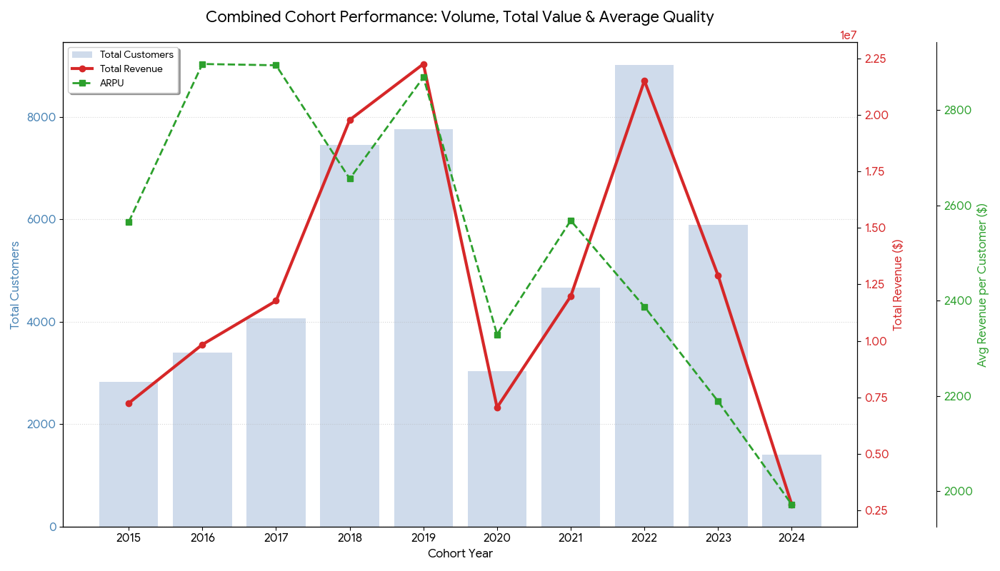
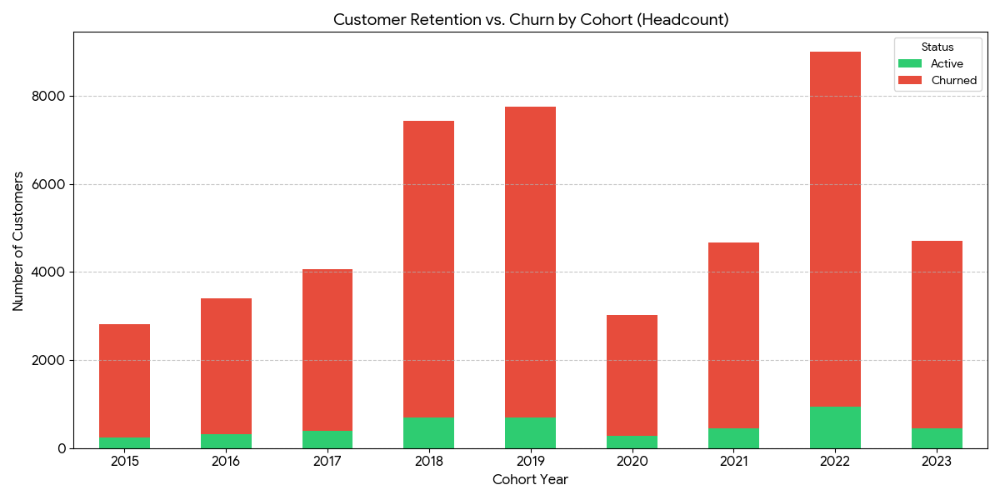

# intermediate SQL - Sales Analysis

## overview 
This project implements a sophisticated segmentation framework to analyze purchasing behavior and lifetime value (LTV). By identifying high-impact cohorts, the analysis provide actionable strategies to reduce churn, optimize marketing spend, and unlock revenue growth across low, mid and hight-value customer segments. 

## Business Questions 
1- Customer Segmentation: Who are our most valuable customers?

2- Cohort Analysis: How do different customer groups generate revenue?

3- Retention Analysis: Which customers haven't purchased recently?

## Analysis approach  

### 1. Customer Segmentation Analysis

1. High-Value Segment (66% Revenue)
Target: 12,372 VIP Customers

- Strategy: Retention & Advocacy.

- Action: Launch premium membership; provide dedicated support and early product access.

- Risk: High sensitivity; losing one customer significantly impacts the bottom line.

2. Mid-Value Segment (32% Revenue)
Target: 24,743 Customers

- Strategy: Upsell & Expansion.

- Action: Use "Next Best Product" recommendations and personalized milestone promotions.

- Goal: Bridge the $68.8M gap to convert Mid-Value behaviors into High-Value patterns.

3. Low-Value Segment (2% Revenue)
Target: 12,372 Customers

- Strategy: Activation & Efficiency.

- Action: Automated re-engagement loops and price-sensitive flash sales.

- Goal: Increase purchase frequency to move the $4.3M segment into the Mid-Value tier.

Query: 🖥️ Query: [1_customer_segmentation.sql](./1_customer_segmentation.sql)

📈 Visualization:

### 📊 Key Findings:

1. The "Equal Tail" Distribution

 Interestingly, your High-Value and Low-Value segments have the exact same customer count ($12,372$). This suggests a perfectly symmetrical segmentation logic (likely based on percentiles or tertiles), yet the revenue contribution is drastically skewed:
- High-Value customers contribute ~65.5% of total LTV.
- Low-Value customers contribute only ~2.1% of total LTV.

2. The 4x Leap

The jump from Mid-Value to High-Value is massive. An average High-Value customer is worth 4.06x more than a Mid-Value customer ($10,946$ vs $2,693$). This indicates that your top tier isn't just "slightly better"—they are likely power users or enterprise-level clients.

3. Mid-Value Volume

The Mid-Value segment is your largest by headcount ($24,743$), representing 50% of your total customer base. They provide the "floor" for your revenue, contributing roughly 32% of total LTV.

###  Key Business Insights:

- The 31x Multiplier: One "High-Value" customer is worth 31x more than a "Low-Value" customer. Your business is driven by a small elite, not the masses.

- The Revenue Anchor: Your High-Value segment ($12,372$ people) generates 65% of your total revenue.

 - If you lose 1,000 of these customers, you'd need to acquire 31,000 low-value customers to break even.
 
- Mid-Tier Growth Engine: The "Mid-Value" group is your largest ($24,743$ people). This is your primary target for upselling; they have already shown commitment but haven't reached "power user" spend yet.
 
 - Low-Value Drain: The "Low-Value" tier contributes only 2% of total LTV despite being 25% of your head count. Ensure your acquisition cost (CAC) for this group is near zero, or you are losing money on them.

### 2. Cohort Analysis

- Tracked revenue and customer count per cohorts

- Cohorts were grouped by year of first purchase

- Analyzed customer retention at a cohort level

Query:  [2_cohort_analysis.sql](/2_cohort_analysis.sql)

**Visualization:**

### 📊 Key Findings The "Golden Era" (2016–2019): 

- These cohorts were your most efficient. They maintained the highest Average Revenue Per User (ARPU), peaking at $2,896.The 2022 Volume Peak: This was your most successful year for customer acquisition ($9,010$ customers), but it marked a shift toward a lower-value customer profile.

- The ARPU Slide: Since 2021, the average value of a new customer has dropped every single year, reaching a low of $1,972 in 2024—a 32% decline in quality from the peak.

- 2020 Contraction: The business saw a massive 60% drop in acquisition during 2020, which also correlated with a dip in individual customer spending.

### Business Insights:
 - Quantity $\neq$ Quality: Your 2019 cohort generated more total revenue than the 2022 cohort, despite having 1,255 fewer customers. You are currently working harder (acquiring more people) for less total return.
 
 - The Retention Priority: Because the 2022 cohort is so massive, even a small increase in their churn rate will have a catastrophic impact on your future revenue.
 
 - Protecting this specific group is your #1 priority. 
 
 - Premium Strategy Gap: The steady decline in ARPU suggests your current product or marketing is attracting "bargain hunters" rather than high-value users. 
 
 - You need a "Premium" or "Enterprise" tier to pull the green ARPU line back up.
 
 - 2024 Warning: Even accounting for 2024 being an incomplete year, the ARPU is at an all-time low. This indicates that your most recent customers are the least profitable in your company's history.

### 3. Customer Retention 

Query:  [3_Retention_analysis.sql](/Scripts/3_Retention_analysis.sql)

**Visualization:**

**Key Findings:**

- Extreme Churn Rates: Across all cohorts, churn is exceptionally high, consistently hovering around 90% to 92%. This means only about 8% to 10% of customers acquired in any given year remain active today.

- Stability in Retention: Despite the massive volume changes (e.g., the 2022 surge), the retention rate is remarkably stable. It has slightly improved from 8% in the 2015 cohort to 10% in the 2022 and 2023 cohorts.

- The 2022 "Survival" Peak: Although the 2022 cohort was your largest, its 10% retention rate means you still have 937 active customers from that year—the highest absolute number of active survivors from any cohort in your history.

- Headcount Contrast: In the 2019 "Golden Year," you acquired 7,755 customers, but only 687 are still active today. In contrast, 2022 brought in more volume and has maintained a higher survivor count ($937$).

**Business insights:**

- The "Leaky Bucket" Crisis: Your business has a severe retention problem. Since $\sim 91\%$ of every cohort churns, your growth is almost entirely dependent on acquiring massive new cohorts every year just to stand still.

- Retention is Your Highest Leverage Point: A small 5% improvement in retention (moving from 10% to 15%) would be equivalent to increasing your new customer acquisition by 50%. It is much cheaper to keep the 90% who are leaving than to find new ones.

- Product-Market Fit for the "10%": There is a small, loyal core (the ~10%) that stays active for years. You need to profile these 237 customers from 2015 who are still with you after 9 years. They hold the "DNA" of your ideal customer.

- Cohort Fatigue: The 2023 cohort is already at 90% churn, similar to cohorts that are much older. This suggests that churn happens very early in the customer lifecycle (likely within the first 12 months).

### Strategic Recommendations

#### 1- Customer Segmentation (LTV):

- **Defend the "Whales":** High-value customers generate 65% of your value. Assign dedicated account managers or a "VIP" support line to this group immediately; a single lost customer here is a massive hit.

- **Upsell the "Middle":** The mid-value group is your growth engine. Identify the specific features used by high-value customers and create targeted "bridge offers" to migrate the mid-tier upward.

#### 2- Cohort Performance:

- **Shift from Quantity to Quality:** ARPU (green line) is in a 4-year decline. Stop chasing raw customer volume (the blue bars) and return to the 2019 "Golden Era" strategy that prioritized higher spending per user.

- **Investigate the 2022 Cohort:** This was your largest acquisition year, but spending is low. Run a re-engagement campaign specifically for this massive group to prevent them from settling into a low-value pattern.

#### 3- Retention vs. Churn

- **Fix the Onboarding Leak:** With ~90% churn across almost all years, your "bucket" is broken. You must implement a high-touch onboarding sequence in the first 30 days to keep customers before they become part of the red "churned" bars.

- **Analyze the "Survivors":** Study the active customers from the 2015–2018 cohorts. These "super-loyalists" represent your true Product-Market Fit; find out what they have in common and use that profile to refine your future marketing.

## Technical details:

- Database: PostgreSQL
- Analysis Tools: PostgreSQL, DBeaver, PGadmin
- Visualization: 
Gemini
